# Manta TV firmware emulator

Booting the **real, unmodified firmware** of Manta televisions in software and watching its own OSD come to life: no UI re-created in host code, no patched firmware, no invented hardware answers. Two very different platforms are covered:

| platform | sets | status |
|---|---|---|
| **MStar MSD309** (Titania4, MIPS) | Manta LCD4214 | boots from the reset vector to its own NO SIGNAL screen; menus, remote, USB player and USB software update, HDMI input with 3D, analogue tuner with stations and teletext, DTV scan / channel names / programme guide / MPEG-2 video. No sound. Details and what is real vs exploratory: [docs/STATUS.md](docs/STATUS.md) |
| **Sunplus SPHE8600** (MIPS + DSP ASE, eCos + DirectFB) | Manta LED4202, Shivaki STV-24LED14 | kernel boot, SPI-flash model, application starts, DirectFB 1.1.0 initialises; real OSD menu renders and is navigable (exploratory GPU model) |

**[Showcase and live firmware](https://vthreex.github.io/manta-emulator/)** (the original MStar firmware running in your browser, with USB / HDMI / antenna / DTV inputs; recorded menu explorations of both sets; boot walkthrough; gallery) | **[Releases](../../releases)** | [Architecture notes](docs/sunplus-sphe8600-architecture.md) | [Firmware images and hashes](firmware/README.md)

## Gallery (real frames from the emulator)

| | | |
|---|---|---|
| 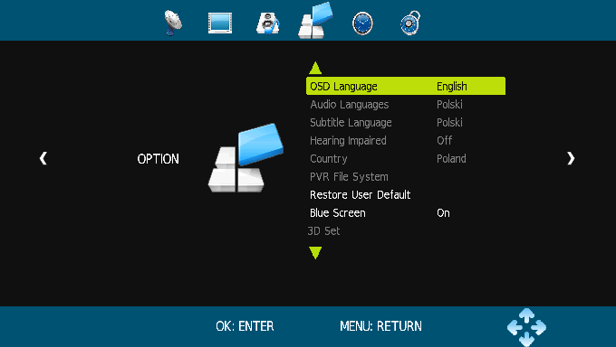 | 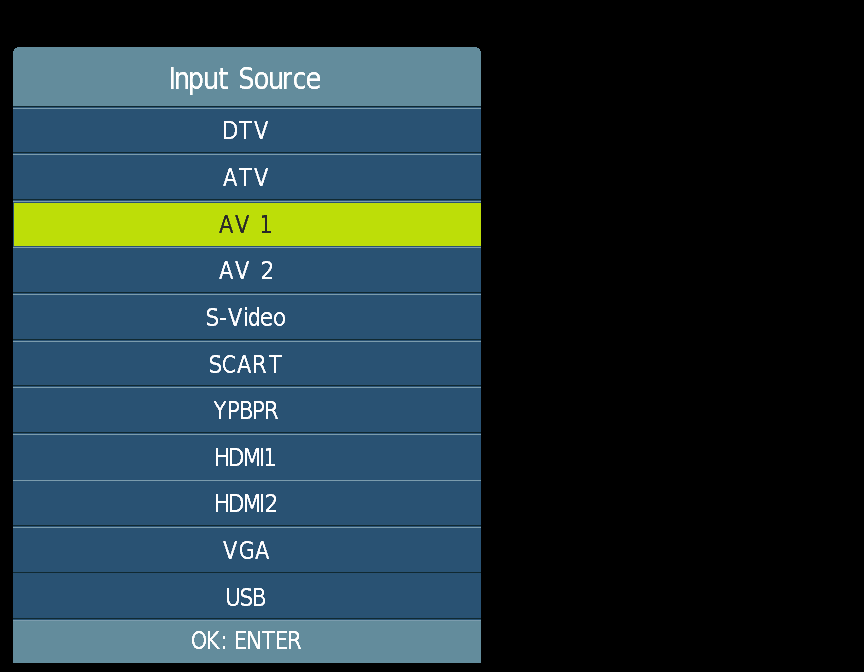 | 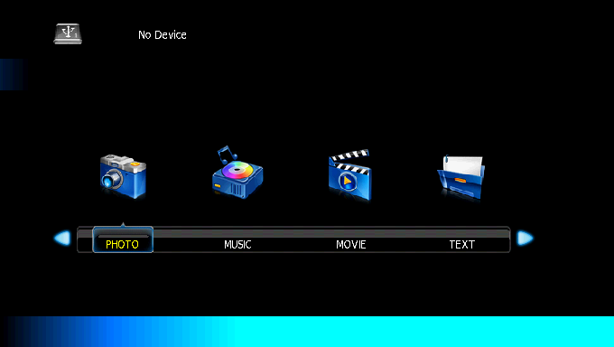 |
| Option menu (MENU key) | Input source list | USB player, no device |
| 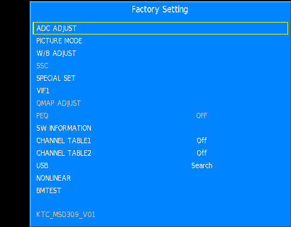 | 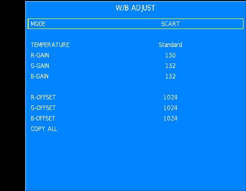 | 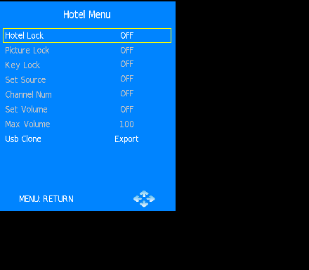 |
| Factory menu | Factory white balance | Hotel menu |
| 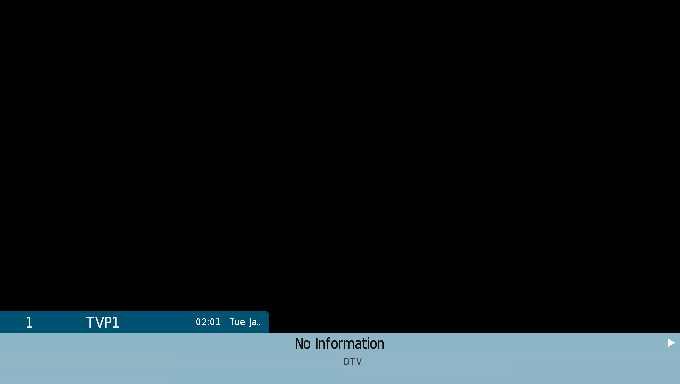 | 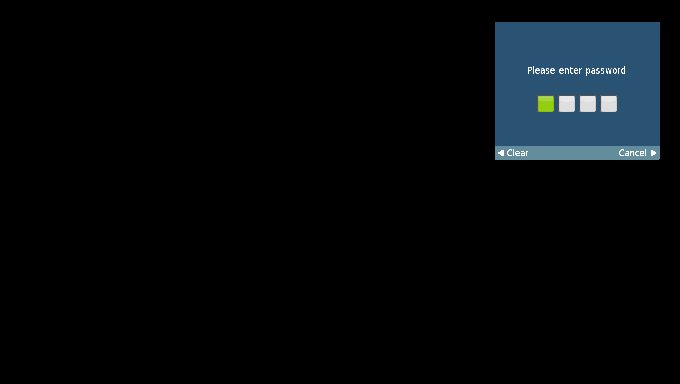 | 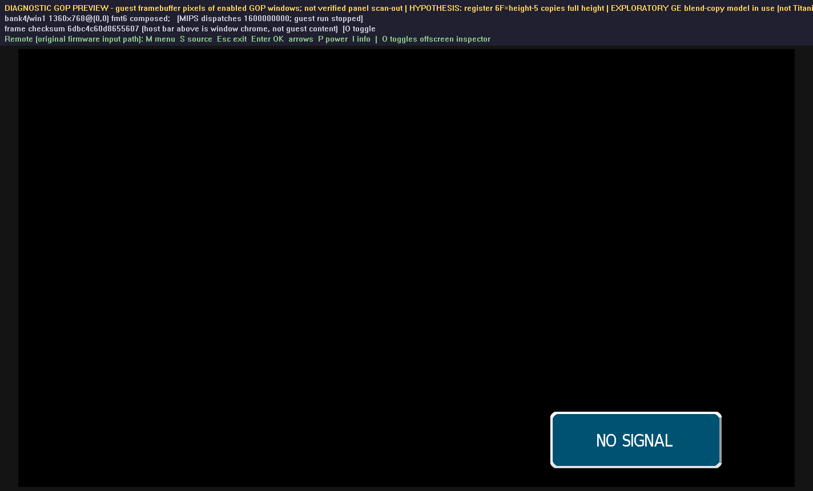 |
| Digital TV banner | Lock password dialog | NO SIGNAL dialog drawn by the original ZUI |

| 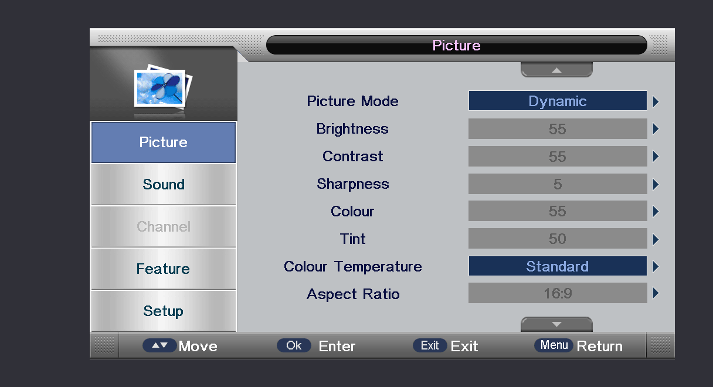 | 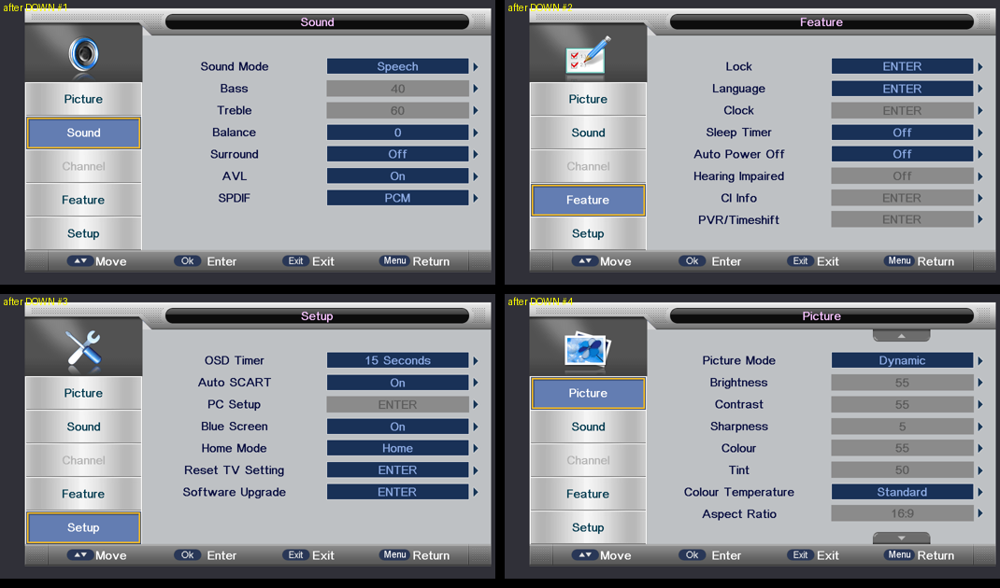 | 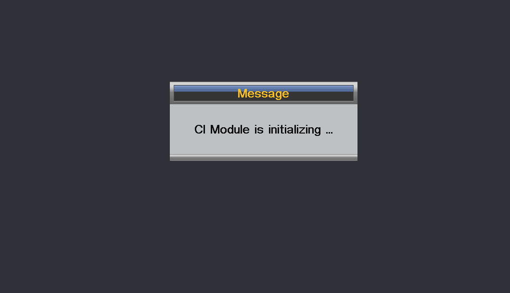 |
|---|---|---|
| Sunplus LED4202: main menu | Sound / Feature / Setup tabs | "CI Module is initializing" after selecting DTV |

Sunplus boot logos (recovered from the flash images), the 632-bitmap OSD atlas and the recorded menu session are on the showcase page.

## Highlights

- **Strict by default.** Unknown hardware stays unknown; every hypothesis is opt-in, labelled and listed in the run report. Diagnostic results are kept separate from connected-boot progress and from displayed pixels.
- **Fast.** A statically recompiled native engine (cold boot to NO SIGNAL in ~50 s, ~23 M instructions/s on a DTV channel), exact idle-loop skipping for the side cores, and full-machine save states (a checkpoint loads in about a second).
- **Runs in the browser.** The same engine compiled to WebAssembly is the live page's "Live firmware" tab.
- **Qt control centre** (`frontend/manta_control.py`): board switch, remote (keys and mouse), machine settings, live preview, frame sharing over shared memory.
- **Reverse-engineering notes** for both platforms: register maps, boot flow, flash layouts, interrupt controller, GE/GOP/OSD formats (`docs/`).

## Quick start

- **Browser:** open the showcase page, choose **Live firmware**, press Start.
- **Desktop GUI:** `python frontend/manta_control.py` (Qt control centre: remote, inputs, machine settings, live preview). See [docs/frontend.md](docs/frontend.md).
- **Command line** (native engine from a save state, headless):

```powershell
.\manta_native_full.exe --firmware firmware\manta-lcd4214-original.bin --native-cpu --load-state STATE.snap --headless --max-instructions 2000000000 --summary out.json
```

`--native-cpu --native-cold-boot` without `--load-state` boots from the reset vector. Every hypothesis flag is listed in the run summary; the
DTV, ATV, HDMI and USB models and their flags are described in the docs linked from [docs/STATUS.md](docs/STATUS.md).

## Build and test

Windows, MinGW-w64 (g++/gcc), CMake + Ninja, Unicorn 2.1.4 with the patches in `third_party/` (`tools/bootstrap.ps1` sets this up; it has
not been re-verified end-to-end recently). Targets: `manta` (interpreter), `manta_native_full` (recompiled engine, needs `native/gen` from
`native/tools/gen_boot.py`), `core_tests`. The web build is `python native/web/build.py` (Emscripten); the output goes to `site/live/`.

```powershell
ninja core_tests; .\core_tests.exe     # 4,478 checks, no firmware needed
```

The Python regression drivers in `tests/` need the original firmware image. No CI job runs them yet.

## Layout

`src/` emulator core | `native/` recompiled-engine runtime | `frontend/` Qt control centre | `tools/` analysis and test drivers | `docs/` findings and register maps | `evidence/` validation logs and captured frames | `configs/` policies and key maps | `firmware/` test images | `site/` GitHub Pages showcase

## Authorship and credits

This project was directed, tested and published by **v3x**, and built together with AI coding assistants, credited as they were used:

- **OpenAI Codex** did the first reverse-engineering phase (2026-10-11 to 2026-10-18).
- **Claude** (Anthropic, via Claude Code) did the work after that hand-off: the emulator extensions, the Qt control centre, the Blaupunkt/Sunplus bring-up and this site. Those commits carry a `Co-Authored-By: Claude` trailer, so Claude appears as a contributor in the history.

## Licence

GPL-2.0 (see `LICENSE`), matching the bundled Unicorn engine and libmpeg2 0.5.1 (`third_party/libmpeg2`, GPL-2.0-or-later, used for DTV video). Firmware images and extracted artwork belong to their owners and are included for interoperability and preservation research only.

---

History: the former development log and run/build notes are in [docs/history/](docs/history/).
