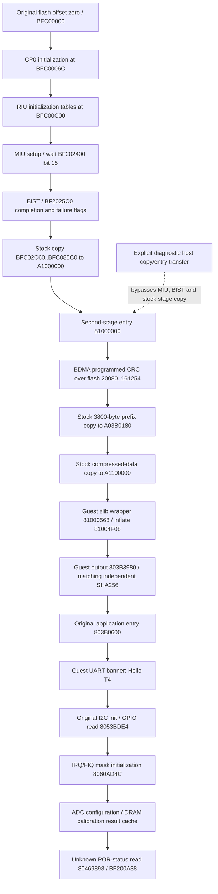

# Observed boot flow

Reset mapping `0xBFC00000` is conventional MIPS KSEG1 and consistent with this image's absolute branches and flash pointers. Physical boot wiring is not independently confirmed. Unicorn translates these accesses to physical `0x1FC00000`.

With `--candidate-miu --candidate-bdma --candidate-uart --gpio-i2c --symbolic-init`, the observed command sequence initializes digital guest DRAM, original BIST tests memory, and the guest reaches every reset-to-runtime checkpoint without the host stage copy or entry transfer. Completion timing and five calibration test patterns remain approximations. See [cold trace](../evidence/cold-boot.jsonl).

Without those models, strict execution stops earlier at `BFC00C60`, byte read `BF001C74`, because reset bits are unknown. Symbolic initialization preserves unknown bits through proven RMW code and reaches the MIU-ready polling loop. It does not synthesize readiness. The optional diagnostic initialization prefix executes the real early code up to `BFC01A74`, before that poll, and then transfers to the host-loaded second stage.

The second-stage region is `0x2C60..0x85C0`, length `0x5960`. Its stack is `0x80A80000`. Its zlib allocator is initialized with `0x82100000`; the guest runs its own allocation and inflation code. No host decompression supplies the application's main image to the machine.

Runtime header at flash `0x20000`:

| Field | Stock value | Evidence |
|---|---|---|
| Source | `BFC20080` | Header and second-stage loads |
| Destination | `A03B0180` | Header / prefix copy |
| Compressed RAM end | `A04F1354` | Header; describes compact loaded region, not expanded end |
| ROM end | `BFD61254` | CRC/copy range includes padding |
| Entry | `803B0600` | Guest indirect transfer at `810000AC..B0` |
| CRC | `5F65D0D4` | Programmed MSB polynomial `04C11DB7`, seed zero; actual bytes match |

Guest prefix length `0x3800` is a loader constant at `810008B0`. It places the main DEFLATE output at `803B3980`. Output length `3,167,072` ends at `806B8CE0`. At runtime entry, the machine hashes those guest-written DRAM bytes and compares to `149c6d713a91017eff5352fe2227e9dc99603869683ac8a57b66c83bc63ef236`.

The GPIO boundary is reached in a routine consistent with GPIO-bitbanged I2C bus initialization/recovery: paired GPIO descriptors, a delay loop, SDA sampling, and a nine-iteration loop. This interpretation is an engineering inference. The initial pair table at `806563F8` contains logical GPIOs 65/66 and delay 40. GPIO 66's input descriptor is RIU logical `101E83`, mask `04`, mapping to byte `BF203D05`. The subsequent decision at `803BCFB4` depends on the result. The explicit GPIO/I2C model resolves released pins through pull-ups, and a stuck-SDA electrical fixture invokes the guest's own nine recovery clocks/error path. No slave ACK/data is fabricated. See [schematic cross-reference](gpio-cross-reference.md).

See [strict trace](../evidence/reset.jsonl), [second-stage trace](../evidence/stage2.jsonl), [prefix/UART trace](../evidence/prefix-uart.jsonl), and their adjacent summaries. Counters count instruction/access dispatch observations, not retired instructions or calibrated silicon cycles.
